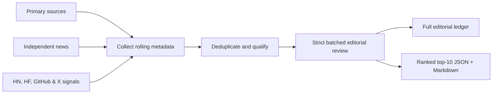

# AI Builder Brief

Source-linked, decision-changing AI developments for builders: published as daily written field notes and backed by a [CastForge](https://github.com/lifan-builds/castforge) review and audio pipeline.

- **Website:** [https://clifan.com/ai-builder-brief/](https://clifan.com/ai-builder-brief/)
- **Daily Written Archive:** [https://clifan.com/journal/ai-builder-brief/](https://clifan.com/journal/ai-builder-brief/)

## Workflows

### 1. Daily Written Brief, Journal & Media Packs

The daily written briefing uses [`brief_sources.yaml`](brief_sources.yaml) and archives verified editions under `history/YYYY-MM-DD.md` (see [DAILY_BRIEF.md](DAILY_BRIEF.md)):

```bash
# Validate the daily brief source catalog
.venv/bin/python scripts/validate_brief_sources.py

# Publish archived briefs into the clifan.com journal HTML tree
.venv/bin/python -m ai_builder_brief journal --date YYYY-MM-DD --site-root /path/to/lifan-builds

# Generate hero artwork, RedNote cards, and narrated audio via loopback Quotaswitch (127.0.0.1:18455/v1)
.venv/bin/python scripts/generate_media_pack.py --latest-issue

# Render an X thread from a structured review JSON artifact
.venv/bin/python scripts/render_x_thread.py build/review/YYYY-MM-DD.json
```

### 2. CastForge Editorial Review & Podcast Pipeline

Every selected podcast story requires an authoritative primary source or two independent reports, and episodes publish a source manifest, VTT transcript, and chapters. During editorial tuning, the scheduled workflow runs `--review-only` and does not invoke NotebookLM, transcription, R2, or RSS publication.



```bash
python3 -m venv .venv
.venv/bin/pip install -e ".[test]"

# Offline fixture proof (writes feed, source doc, manifest, transcript, chapters, and site to build/fixture/)
.venv/bin/python -m ai_builder_brief run --fixture --date 2026-08-11

# Live source collection + batched editorial review via loopback Quotaswitch gateway
.venv/bin/python -m ai_builder_brief run --date YYYY-MM-DD --review-only
```

## Sources & Policy

Podcast collector sources live in [`sources.yaml`](sources.yaml); written-brief coverage lanes live in [`brief_sources.yaml`](brief_sources.yaml). Only titles, URLs, dates, attribution, and short summaries are stored; full articles and paywalled content are never scraped or republished. See [SOURCE_POLICY.md](SOURCE_POLICY.md).

## Development

```bash
.venv/bin/pytest
.venv/bin/python -m ai_builder_brief run --fixture --date 2026-08-11
```

## Project Documents

- [DAILY_BRIEF.md](DAILY_BRIEF.md) — coverage lanes, evidence bundle contract, and source-panel maintenance
- [SOURCE_POLICY.md](SOURCE_POLICY.md) — source eligibility and content-use rules

## License

Copyright © 2026 [lifan-builds](https://github.com/lifan-builds). **All Rights Reserved** — source-available for **personal non-commercial use** and **upstream Pull Request contributions only** under [LICENSE](LICENSE) (`LicenseRef-lifan-builds-Proprietary`). Commercial use, hosted wrappers, rebranding, standalone forks/mirrors, and dataset/HTML extraction without prior written permission are prohibited. Pull Requests are welcome under [CONTRIBUTING.md](CONTRIBUTING.md).
